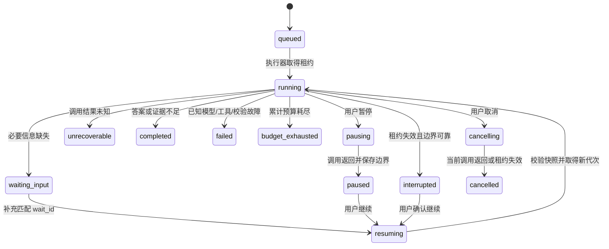

# 可暂停、可恢复的文档调查

本版围绕同一调查保存执行状态；不是通用聊天记忆或工作流编辑器。继续复用原有受限动作、
证据读取、引用校验、可选规划和答案复核。所有默认验证使用原创合成内容，不访问付费 API。

## 四项能力分别验收

| 能力 | 执行语义 | 验证入口 |
| --- | --- | --- |
| 进度重新订阅 | GET 订阅不启动执行；断线不取消；按单调事件序号补收并去重 | 前端 API 单测、真实后端浏览器断网/刷新回归 |
| 等待补充后继续 | `waiting_input` 保存问题和证据；补充绑定 `wait_id`，保留编号及累计预算 | `tests/test_investigations.py`，真实后端浏览器回归 |
| 主动暂停后继续 | `pausing` 等当前调用返回且结果落盘；`paused` 才表示已停止推进 | 模型/检索/复核中暂停测试，页面内及真实后端浏览器回归 |
| 服务进程重启 | 从保存的阶段恢复；已保存结果不重发；结果未知时停止恢复 | 强制退出子进程测试、重建 FastAPI/执行器测试、真实后端停止/重启回归 |

## 启动与完整演示

已有真实索引和模型配置时，原 `scripts/serve.py --enable-agent` 会启用持久调查，默认数据库为
`indexes/investigations/runs.sqlite3`，可通过 `--investigation-db` 指定。首次创建后获得稳定 `run_id`。
构建前端后打开 `/workbench/`，切换“连接服务”。左侧历史入口加载最近一百次调查，选择后恢复
执行图、时间线、已读证据和答案引用。主题、模型入口及检查器保持原有方式。

无需语料和密钥的完整演示：

```powershell
uv sync --extra dev --extra service --python 3.13
npm --prefix frontend ci
npm --prefix frontend run build
.venv/Scripts/python.exe scripts/serve_investigation_demo.py
```

1. 打开 `http://127.0.0.1:8011/workbench/`，选择“连接服务”。模型显示 `synthetic-demo`。
2. 发起“星桥集群是否可以升级？”。后端读取原创合成证据，再询问当前版本和目标版本。
3. 刷新页面：应回到同一调查，历史和证据仍在。也可从“运行历史”重新选择。
4. 在原调查填写“甲版升级到乙版”，点击“提交补充并继续”，随即点击“暂停调查”。
   若当前调用尚未返回，会先显示“正在暂停”；等待变成“已暂停”。
5. 在运行演示后端的终端按 Ctrl+C，使用**同一命令、数据库及 delay 配置**重启。
6. 刷新页面，确认同一调查仍是已暂停，点击“继续调查”。它沿用已读证据和预算完成答案。
7. 点击答案引用，核对“版本准备”和“回退演练”的完整合成原文；展开已提交补充信息核对输入。

演示后端默认每次假模型调用延迟两秒，便于操作；不代表模型速度或质量。`--delay` 可调整，
但它也进入合成模型配置指纹，恢复时应保持不变。默认数据库为 `indexes/investigations/demo.sqlite3`。
原纯前端演示继续可用，新增“暂停与恢复”场景展示原地补充、暂停和继续；该场景只在页面内存，
不会冒充跨进程持久恢复。

## 状态机与所有权



等待、暂停、排队、中断任务可取消；无执行者时直接进入 `cancelled`。终态为 `completed`、
`cancelled`、`failed`、`budget_exhausted`、`unrecoverable`，只读保留历史，不能原地恢复。
`completed` 的实际结果可能是答案，也可能是证据不足，前端按 `response.status` 展示。
暂停若与已完成的最终校验竞争，最终结果允许先提交；不会为了显示暂停而丢弃已确认答案。
取消若先提交，则禁止随后发布答案。

SQLite 使用 `BEGIN IMMEDIATE` 事务串行化状态命令；执行者持有 `owner + epoch + lease_until`。
默认租约十五秒，调度器每 250 毫秒巡检并为活跃执行更新租约；每个执行边界也检查所有权。
写入必须匹配 owner/epoch 且租约未到期。接管时 epoch 递增，旧执行者的迟到结果无法写入或继续。
尚未过期的租约不能被新服务抢走；硬崩溃后需等待租约过期。系统时间应稳定，时钟倒退可能延迟接管。

调度器、旧 API、搜索和问答在同一服务内共用并发 admission；后台任务持有槽位直到阻塞调用返回。
支持对同一数据库的跨执行器抢占防重，但部署仍为本机单用户、一个服务进程；多进程之间没有全局
检索并发额度，不把 SQLite 租约描述为分布式工作队列。服务启动只自动推进已排队/已提交恢复的任务；
识别出的 `interrupted` 任务等待用户点击继续，避免启动服务便意外产生新模型费用。

## 数据合同和检查点

数据库 `PRAGMA user_version=1`；任务、检查点、事件和调用尝试均有 `schema_version=1`。
不支持的数据库版本拒绝打开，不猜测迁移。使用 WAL、FULL 同步及外键级联删除；硬件或文件系统
违反同步保证、磁盘损坏、直接改库以及网络文件系统不属于已验证范围。

| 合同 | 必需内容 |
| --- | --- |
| `runs` | run_id、创建幂等键、原问题、补充列表、模型 ID、Agent 配置指纹、文档快照、预算配置、状态/原因、控制版本、执行者/代次/租约、累计主动时间、当前 wait_id、结果、事件游标 |
| `checkpoints` | 每个任务最新的检查点、revision、阶段、可恢复 Agent 状态、已保存模型/检索结果、进度 recorder 状态、已应用补充条数 |
| `events` | `(run_id, seq)` 唯一键、schema 版本、kind 和 payload；与状态/检查点在同一事务内提交 |
| `attempts` | 唯一调用 ID、run_id、epoch、kind、started/completed/failed/unknown、开始/结束时间、结果或固定错误码 |
| `commands` | `(run_id, request_id)` 唯一键与规范化请求内容；阻止网络重试重复执行 |

检查点采用明确白名单的 JSON 类型编码，保存候选全文、已读证据及编号、搜索去重集合、模型/搜索/
读取次数、累计估算输入 token、规划/评估结果、待复核答案、复核次数和反馈、已验证动作等。
恢复时直接加载这些状态，**不从初始问题重新跑循环，也不靠 SSE 事件重建执行**。
原问题与各轮补充分别存储；模型输入包含累积补充。补充后重新建立可选需求计划/覆盖评估，保留证据、
调用历史和预算；重新规划同样消耗模型预算。检查点不保存 SDK、线程、网络对象、密钥或 reasoning 字段。

| 持久阶段 | 恢复行为 |
| --- | --- |
| `decision` | 继续下一次模型决策；先检查累计步数、时间、token 与上下文大小 |
| `model_result` | 消费已保存的模型正文或固定错误码，不重发模型请求 |
| `dispatch` | 执行已验证动作；搜索在实际调用前登记尝试和预留计数 |
| `search_result` | 将已保存段落应用到候选映射，不重复检索 |
| `model_call` / `search_call` | 只证明调用已登记；进程失联后标为结果未知，不自动重试 |
| `finished` | 终态，只读查看或清理 |

模型调用在发出前将尝试、预留调用/token 预算和开始事件一起提交；返回后先持久化正文，再解析/分派。
检索也先保存结果，再应用候选。读取已保存候选没有外部副作用，其完成尝试与证据更新同事务提交；
纯本地校验/读取若在提交前崩溃，可从前一个可靠边界重复计算。每个边界只保留最新检查点，历史事件和
有限预算内的调用结果保留到清理。

如果“外部请求已成功、结果尚未提交”时崩溃，无法区分未发送与已完成，状态为
`unrecoverable / call_outcome_unknown`。本版选择保留记录并引导新建调查，不自动重试未知调用，
不承诺外部调用 exactly-once 或不会重复计费。尝试是一次 Agent 逻辑模型/检索调用；供应商客户端的
内部 HTTP 重试、检索内部 embedding/rerank 请求沿用原配置，不逐一作为独立 Agent 尝试统计，也不能
从模型调用次数推算账单。恢复不重放已保存调用，但新建任务及供应商重试仍可能产生重复费用。

## 预算、超时与快照

- `model_calls/search_calls/read_calls/prompt_estimated_tokens` 随任务累计，暂停、补充、刷新和重启均不清零。
  token 是现有估算输入量；输出上限由生成器配置控制，并不伪称提供供应商实际 token 账单。
- `max_seconds` 是主动执行预算，包含模型/检索阻塞、客户端重试等待和本地处理；排队、用户等待、已暂停
  及服务离线不计入正常主动时间。心跳和边界事务累积时间；硬崩溃到租约失效的未知尾段保守计至租约到期，
  最多多扣一个租约窗口，避免反复杀进程获得免费执行时间。
- 单次 provider timeout 与调查累计时间独立。沿用既有 provider timeout 和 generation control，
  预算/取消在边界检查；不承诺立即打断同步调用、严格墙钟截止或即时停止计费。长检索内部调用也受其
  provider 的超时/重试配置约束，返回后若主动预算已耗尽，保留结果但不发布未经完成校验的答案。
- 创建时绑定模型 ID、Agent/生成器/提示词/预算指纹及已发布文档清单快照。生产服务固定物理 Milvus
  集合，指纹包含发布文档记录、分块、稀疏词表和 embedding profile；别名重新发布不会把存量调查
  静默切到新集合。检查点包含完整候选及已读证据，因此原引用内容可继续查看。
- 服务重启使用不同模型、关键配置或文档快照时，恢复被终止为 `snapshot_or_model_mismatch`。
  本版没有历史索引自动挂载器；应使用原发布配置启动服务并恢复尚未判为终态的任务，或在新快照下新建。
  已发布集合须按仓库发布约定保持不可变；外部直接原地修改数据库不在快照保证范围。

## API 与重试合同

| 请求 | 作用 |
| --- | --- |
| `POST /api/investigations` | `{request_id, query, model?}`，立即返回稳定 run_id 和状态，不等待调查完成 |
| `GET /api/investigations` | 最近一百条摘要；无证据正文 |
| `GET /api/investigations/{id}` | 状态、控制 version、当前 wait_id、完整历史、引用、usage、cursor、检查点边界和脱敏尝试元数据 |
| `POST /api/investigations/{id}/pause` | `{request_id, version}` 合作式暂停 |
| `POST /api/investigations/{id}/resume` | `{request_id, version}` 从 paused/interrupted 继续 |
| `POST /api/investigations/{id}/cancel` | `{request_id, version}` 取消；与暂停不同的终态 |
| `POST /api/investigations/{id}/supplement` | `{request_id, version, wait_id, text}`，只接受当前等待阶段 |
| `GET /api/investigations/{id}/events?after=N` | 按序补收，单页最多 256 条，返回最后 seq 后继续取下一页 |
| `GET /api/investigations/{id}/stream?after=N` | SSE 补收并继续实时订阅；也接受 `Last-Event-ID`，存在时优先 |
| `DELETE /api/investigations/{id}` | 仅删除终态任务及其检查点、事件、调用结果和幂等记录 |

创建/控制请求相同 request_id 和相同内容返回当前调查，不重复执行；同键不同内容返回
409 `idempotency_conflict`。不同命令的旧 version 返回 409 `stale_run_version`；不匹配 wait_id
返回 409 `stale_clarification`；非法状态返回 409 `invalid_run_state`，终态返回 409 `run_is_terminal`；
不存在返回 404 `run_not_found`；无效字段/游标为 422。精确错误优先级以版本检查在前。
幂等键在任务保留期间有效，清理后不再保证旧键防重。

SSE `id` 为任务内全局 seq，`run_event` 包含 schema_version/run_id/seq/kind/payload；kind 包括
state、progress、supplement。`progress` 的 invocation_id 在恢复后延续；前端丢弃重复 seq，发现缺口
重新获取完整状态。快照的 cursor 与检查点同一读事务；流始终从同一持久日志按游标读取，没有“历史
补收切换到内存队列”的丢事件窗口。进度展示可以延迟，订阅本身绝不推进、重试或取消模型调用。

能力接口新增 `agent_persistence`；React 优先使用新接口，老服务继续走原请求级接口。
`/api/investigate`、`/api/investigate/stream` 和旧静态页保持原语义，包括旧流断线请求取消、追问后另建
请求。这些旧入口不具有持久恢复能力，不能拿旧 run_id 调用新接口。

## 本地数据与清理

所有运行数据默认位于 Git 忽略的 `indexes/investigations/`。正文、用户问题、补充和模型动作需要保存，
但不保存密钥、完整网络响应头、供应商隐藏推理或外部诊断堆栈。浏览器 localStorage 只记主题、模式、
所选模型与当前 run_id；问答及证据来自本地后端，不放入 localStorage。

任务终态后调用 DELETE 清理，例如：

```powershell
Invoke-RestMethod -Method Delete -Uri "http://127.0.0.1:8011/api/investigations/<run_id>"
```

活跃任务须先取消并等待终态。删除级联清理数据库记录，启用 secure_delete 并尝试截断 WAL；不保证
操作系统备份、文件系统快照或硬盘上的安全擦除。要彻底重置本地工作区，先关闭服务，再删除明确选定的
`runs.sqlite3`（或 `demo.sqlite3`）及对应 `-wal`/`-shm` 文件；不要在服务运行时单独删 WAL。
没有默认定时保留期；本版由用户显式清理。服务只监听本地回环，不增加账户、多租户和公网访问能力。

## 验证命令与限制

```powershell
.venv/Scripts/python.exe -m pytest
.venv/Scripts/python.exe -m ruff check src tests scripts
.venv/Scripts/python.exe -m ruff format --check src tests scripts
.venv/Scripts/python.exe -m mypy
npm --prefix frontend test
npm --prefix frontend run build
npm --prefix frontend run format:check
npm --prefix frontend exec playwright install chromium
npm --prefix frontend run test:e2e
npm --prefix frontend run test:persistence
```

最后一项启动独立本地合成后端，真实刷新/断网、暂停、强制停止测试进程、用同一数据库重启，再恢复并
核对答案和引用。测试数据库、截图和 trace 都在忽略的 `frontend/test-results/`。Python 另覆盖模型
结果提交前/后崩溃、并发恢复、过期补充、预算、迟到结果、模型/索引不匹配及复核恢复。
这验证的是工程恢复合同，不是模型质量、吞吐或付费供应商的稳定性；没有重做 v2 审核或使用冻结 test。
